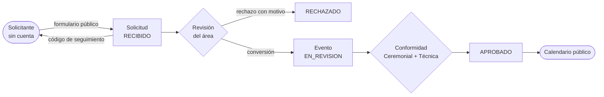
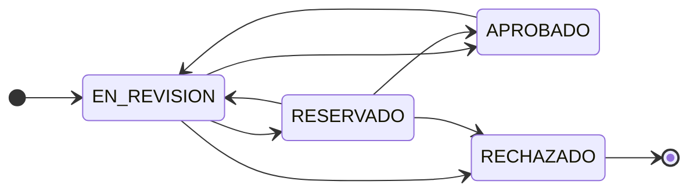

<div align="center">


# Gestión de Eventos

**Sistema de gestión de eventos con validación automática de recursos<br/>para el Área de Ceremonial de la Universidad Nacional de Lanús**

Trabajo Final Integrador · Licenciatura en Sistemas<br/>
Departamento de Desarrollo Productivo y Tecnológico


| Autores | Tutor |
|:---:|:---:|
| Miguel Caraballo · Elian Gonzalez | Lic. Marcos Amaro |

</div>

---

## El problema

La agenda institucional se llevaba en planillas compartidas entre áreas. Nada impedía reservar dos veces un mismo salón, comprometer más asistencia técnica de la disponible o aprobar una actividad sin que Ceremonial y Técnica la hubieran revisado. Tampoco quedaba registro de quién decidió qué.

Este sistema reúne en una sola aplicación web el pedido, la planificación, la aprobación y la consulta de los eventos. Las reglas que antes dependían de la memoria de cada área ahora las controla el sistema.

## Cómo funciona



1. Cualquier persona pide un evento desde el formulario público, sin crear una cuenta. Elige un espacio del catálogo o indica una ubicación libre, y recibe un código para seguir el pedido.
2. El área revisa la solicitud: la rechaza con un motivo o la convierte en evento. Convertir no equivale a aprobar.
3. El evento se aprueba cuando dan su conformidad Ceremonial y Técnica, o la Administración General por ambas. Recién entonces aparece en el calendario público.
4. Las áreas internas coordinan con comentarios, notificaciones y un historial completo de cada evento.

## Perfiles

| Perfil | Qué puede hacer |
|---|---|
| **Solicitante** (sin cuenta) | Pedir un evento, seguir su solicitud y consultar el calendario público. |
| `USUARIO` | Consultar la agenda interna. No crea ni modifica eventos. |
| `ADMIN_CEREMONIAL` | Gestionar solicitudes, eventos y catálogos de espacios y departamentos, dar la conformidad ceremonial y resolver conflictos de prioridad. |
| `ADMIN_TECNICA` | Gestionar solicitudes, eventos y catálogos, dar la conformidad técnica y monitorear la capacidad técnica. |
| `ADMIN_FULL` | Todo lo anterior, dar ambas conformidades y administrar cuentas y roles. |

La interfaz oculta lo que cada perfil no puede hacer, pero la autoridad es el backend: toda operación se valida por rol aunque se invoque directamente contra la API. La matriz de permisos es única y la comparten la interfaz y los tests ([`permisos.json`](frontend/src/libs/permisos.json)).

## Estados

**Solicitud:** `RECIBIDO` → `EN_REVISION` → `CONVERTIDO`, o `RECHAZADO` con motivo. `CONVERTIDO` y `RECHAZADO` son finales.

**Evento:**



`RESERVADO` y `APROBADO` ocupan el espacio y la capacidad técnica. Si se modifica la fecha, el horario, la ubicación o los tiempos de preparación de un evento comprometido, este vuelve a `EN_REVISION` y las dos áreas deben dar de nuevo su conformidad.

## Reglas que garantiza el sistema

- **Disponibilidad de espacios.** Dos eventos comprometidos no se superponen en un mismo espacio. El control incluye los tiempos de preparación y desarme, también cuando cruzan la medianoche.
- **Capacidad técnica.** La asistencia técnica se reparte en bloques con un cupo global. Ninguna reserva o aprobación lo supera, aunque varias se confirmen a la vez.
- **Prioridad.** Un evento de prioridad Alta (Rectorado) puede ocupar un espacio comprometido por otro de menor prioridad. El sistema registra el conflicto y marca al desplazado para reprogramarlo. Dos eventos de prioridad Alta se bloquean entre sí, y la solicitud pública no elige prioridad.
- **Doble conformidad.** Ningún área otorga ni retira la conformidad de la otra.
- **Concurrencia.** Las transiciones de un evento y de una solicitud se aplican de a una. Una edición sobre datos desactualizados se rechaza en lugar de pisar un cambio más reciente.
- **Trazabilidad.** Estados, conformidades, cambios de agenda, comentarios, bajas, conflictos y acciones sobre cuentas quedan registrados con su autor y el momento en que ocurrieron.
- **Privacidad.** El seguimiento público y el calendario público no exponen contactos, comentarios, identidades del personal ni datos de gestión.

## Puesta en marcha

**Requisitos:** Docker con Compose v2. En macOS se usa [OrbStack](https://orbstack.dev); `docker context show` debe devolver `orbstack`.

```bash
cp .env.example .env
# Definí una clave de firma propia. El backend no arranca sin ella.
sed -i '' "s/^JWT_SECRET=.*/JWT_SECRET=$(openssl rand -hex 32)/" .env   # en Linux: sed -i

docker compose up --build
```

| Servicio | Dirección |
|---|---|
| Aplicación | <http://127.0.0.1:8080> |
| Correo de prueba (Mailpit) | <http://127.0.0.1:8025>, con `-f docker-compose.yml -f docker-compose.mail-access.yml` |

Al iniciar, Flyway crea el esquema y carga datos de demostración. Las cuentas de prueba son `admin.full`, `admin.ceremonial`, `admin.tecnica` y `viewer`, todas con la contraseña `admin123`. Sirven solo para un entorno descartable.

[DOCKER.md](DOCKER.md) documenta las variables de entorno, el acceso a MySQL y la inspección de migraciones.

## Pruebas

```bash
# Backend: tests de integración (H2) y reglas de arquitectura
cd backend && ./mvnw -q test

# Frontend: chequeo de tipos y build
cd frontend && npx tsc -b && npm run build

# De punta a punta: levanta un stack aislado, corre el smoke de API y Playwright, y lo descarta
bash scripts/e2e/run.sh
```

La suite de backend cubre las reglas de negocio de punta a punta sobre HTTP: permisos por rol contra la matriz única, disponibilidad, capacidad técnica, prioridad, conformidades, concurrencia, sesiones y trazabilidad. El runner E2E usa MySQL real y Mailpit, en un proyecto de Compose propio que no toca los datos locales.

## Tecnologías

| Capa | Tecnologías |
|---|---|
| Backend | Java 17, Spring Boot 3.5, Spring Security con JWT, Spring Data JPA, Flyway |
| Frontend | React 19, TypeScript, Vite 7, Tailwind CSS 4, Zustand, React Hook Form + Zod, CASL, FullCalendar |
| Datos | MySQL 8.0 |
| Entorno | Docker Compose, nginx, Mailpit, Playwright |

## Estructura

```text
gestion-eventos-mvp/
├── backend/                 API REST: módulos por dominio en src/main/java/com/mvp/backend/feature
│   └── src/main/resources/db/migration/   migraciones Flyway versionadas
├── frontend/                Interfaz pública e interna (React)
│   └── src/libs/permisos.json             matriz única de permisos
├── scripts/e2e/             Runner de pruebas de punta a punta en un stack descartable
├── docker-compose*.yml      Stack local y variantes de acceso a MySQL y Mailpit
└── DOCKER.md                Guía del entorno local
```

El backend es un monolito modular: cada dominio (`requests`, `events`, `availability`, `tech`, `priority`, `comments`, `history`, `notifications`, `users`, `auth`, `catalogs`) tiene sus propios controladores, servicios y repositorios. Un test de arquitectura impide dependencias no declaradas entre módulos.

---

<div align="center">
<sub>Universidad Nacional de Lanús · Trabajo Final Integrador · 2026</sub>
</div>
