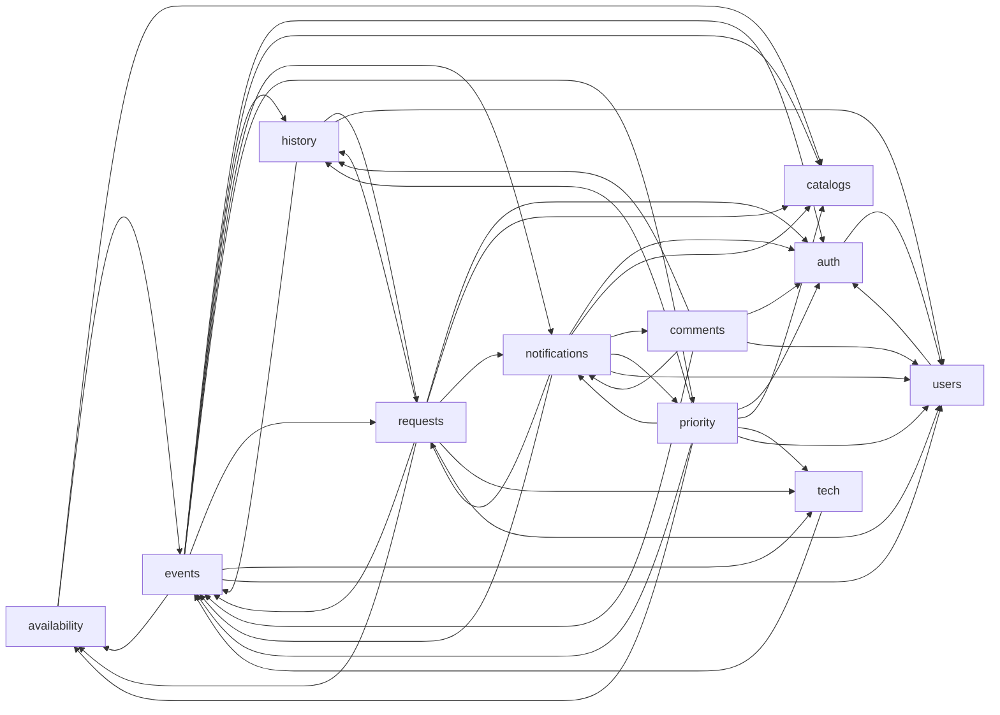

# Arquitectura

El backend es un **monolito modular**: un solo despliegue Spring Boot y una base MySQL compartida, con módulos organizados por capacidad de negocio. “Tipo microservicios” describe la intención de aislar responsabilidades; no significa que hoy sean procesos, bases o transacciones independientes. La separación está parcialmente aplicada y su deuda se conserva explícita abajo.

## Backend: módulos y propiedad

La superficie listada es la que hoy exponen controladores, servicios y DTOs; no implica que exista una API de módulos formalmente publicada. Las tablas se atribuyen al módulo cuya entidad JPA las declara. Las relaciones entre entidades de módulos distintos son válidas en esta base compartida; no transfieren propiedad.

| Módulo | Responsabilidad | Superficie actual (servicios / DTOs representativos) | Tablas propias |
|---|---|---|---|
| `auth` | Login, JWT, refresh/logout y operaciones de sesión. | `AuthService`, `RefreshTokenService`; `LoginRequest`, `LoginResponse`, `RefreshRequest`, `RegisterRequest`, `UserSummary`. | `refresh_tokens` |
| `availability` | Consulta disponibilidad y ocupación de espacios. | `AvailabilityService`; `AvailabilityCheckRequestDto`, `AvailabilityCheckResponseDto`, `PublicAvailabilityCheckResponseDto`, `SpaceOccupancyResponseDto`. | Ninguna entidad/tablas propias observadas; consulta `events` y `catalogs`. |
| `catalogs` | Administración y lectura de espacios y departamentos. | `SpaceService`, `DepartmentService`; `SpaceResponse`, `PublicSpaceResponse`, `DepartmentResponse` y DTOs de creación/actualización. | `spaces`, `departments` |
| `comments` | Comentarios de eventos y su visibilidad. | `EventCommentService`; `CommentCreateDto`, `CommentUpdateDto`, `CommentResponseDto`, `CommentPageDto`. | `event_comments` |
| `events` | Ciclo de vida, agenda, estado y consulta de eventos. | `EventService`, `EventStatusService`; `CreateEventDto`, `UpdateEventDto`, `EventResponseDto`, `StatusChangeResponse`, `StatusOptionsResponse`. | `events` |
| `history` | Auditoría de eventos e historial de solicitudes. | `AuditService`; `AuditEntryDto`, `AuditPageDto`. | `event_history`, `event_request_history` |
| `notifications` | Notificaciones internas y listeners de correo/notificaciones. | `NotificationService`; `NotificationDto`, `UnreadCountDto`. | `notifications` |
| `priority` | Detección y decisión sobre conflictos de prioridad. | `PriorityConflictService`; `PendingPriorityConflictResponse`, `PriorityConflictResponse`, `PriorityConflictDecisionRequest`, `PriorityConflictDecisionResponse`. | `priority_conflicts` |
| `requests` | Solicitudes públicas, seguimiento, revisión y conversión a evento. | `EventRequestService`; `CreateEventRequestDto`, `EventRequestResponseDto`, `TrackingResponse`, `ConvertRequestToEventDto`, DTOs de estado e historial. | `event_requests` |
| `tech` | Configuración y cálculo de capacidad técnica. | `TechCapacityService`; `TechCapacityResponse`, `TechEventResponse`. | `tech_capacity_config` |
| `users` | Perfil y administración de usuarios/roles. | `UserService`, `UserAdminService`; `UserAdminResponse` y DTOs de usuario/rol. | `users` |

`shared`, `config` y `BackendApplication` son infraestructura transversal, no módulos de dominio ni dueños de las tablas anteriores.

## Reglas vigentes

Estas son las reglas de diseño para cambios nuevos. Una desviación actual se registra como deuda; no se convierte en una excepción silenciosa.

1. **Repositorio privado:** el repositorio de un módulo solo se usa dentro de ese módulo. Un módulo consumidor debe pedir una operación al servicio dueño o recibir datos por un contrato explícito.
2. **Controllers locales:** un controller usa servicios/DTOs de su propio módulo y contratos de `shared`/framework; no consume servicios, repositorios ni entidades de otro módulo.
3. **Escrituras por el dueño:** una escritura en tabla de otro módulo se realiza llamando al servicio dueño (por ejemplo, `AuditService`), no guardando directamente su entidad/repositorio.
4. **Eventos con contrato estable:** declarar el evento en `event` del módulo que lo publica; transportar IDs y datos escalares, no entidades JPA. Los efectos posteriores al commit se escuchan con `@TransactionalEventListener(phase = AFTER_COMMIT)`.
5. **Shared neutral:** `shared/` no depende de `feature/`. El manejo de excepciones específico de una feature debe exponerse mediante contratos neutrales o manejarse en su propio límite, no importarse desde `shared`.
6. **Relaciones JPA permitidas:** una entidad puede tener `@ManyToOne`/`@OneToMany` hacia otra entidad de módulo porque hay una sola base y contexto de persistencia. Esa relación no autoriza al servicio consumidor a escribir la tabla ajena.
7. **Cambios de dependencias:** no agregar una dependencia entre módulos sin actualizar este mapa y la guarda `ModuleBoundariesTest`. Hoy esa guarda **no está instalada**: C1 está bloqueado (ver [Deuda](#deuda)); no presentar este requisito como verificado.

## Mapa actual de dependencias

Aristas observadas en imports Java entre paquetes `feature.*` del checkout actual. Es un mapa de dependencias de código, no de llamadas en runtime ni un grafo de dependencias aprobado. La tabla y el diagrama deben actualizarse junto con cambios de imports.

| Origen | Dependencias directas observadas |
|---|---|
| `auth` | `users` |
| `availability` | `catalogs`, `events` |
| `catalogs` | — |
| `comments` | `auth`, `events`, `history`, `notifications`, `users` |
| `events` | `auth`, `availability`, `catalogs`, `history`, `notifications`, `priority`, `requests`, `tech`, `users` |
| `history` | `events`, `requests`, `users` |
| `notifications` | `auth`, `catalogs`, `comments`, `events`, `priority`, `requests`, `users` |
| `priority` | `auth`, `availability`, `catalogs`, `events`, `history`, `notifications`, `tech`, `users` |
| `requests` | `auth`, `availability`, `catalogs`, `events`, `history`, `notifications`, `tech`, `users` |
| `tech` | `events` |
| `users` | `auth` |

Dependencias transversales observadas fuera de `feature.*`: `shared/GlobalExceptionHandler` importa `EmailDeliveryException` (`auth`), `AvailabilityConflictException`/`AvailabilityMapper` (`availability`) y `TechCapacityExceededException` (`tech`); `config/SecurityConfig` importa clases de `auth`; `BackendApplication` inicializa datos mediante `users`.

## Deuda

La deuda se congela: este plan la documenta y busca impedir que aumente; no autoriza una refactorización de estos límites. Prioridad de resolución: escrituras ajenas, ciclo de eventos, repositorios ajenos y luego aristas/ciclos restantes.

| Prioridad | Deuda observada | Impacto / estado |
|---|---|---|
| 1 | `EventRequestService` escribe `Event`, `EventHistory` y `EventRequestHistory` directamente; `PriorityConflictService` escribe `Event` directamente. | El módulo consumidor controla persistencia y ciclo de vida ajenos; cambios parciales pueden desalinear auditoría/estado. En una corrección futura, mover la operación transaccional al servicio dueño. |
| 2 | Los eventos de negocio están agrupados en `feature/notifications/event`, aunque se publican desde `comments`, `events`, `priority` y `requests`. `PriorityConflictEvent` se publica pero el estado actual no muestra listener. | El propietario del contrato está invertido y hay un evento sin consumidor. El plan dispone mover contratos al publisher y usar payloads escalares/IDs; actualmente varios eventos contienen enums de otros módulos, además de IDs. |
| 3 | Hay inyecciones de repositorios de otros módulos. Ejemplos comprobados: `CustomUserDetailsService`→`UserRepository`; `AvailabilityService`→`SpaceRepository`/`EventRepository`; `EventService`→repositorios de `catalogs` y `requests`; `EventRequestService`→repositorios de `catalogs`, `events` y `history`; `PriorityConflictService`→`SpaceRepository`/`EventRepository`; listeners/`NotificationService`→repositorios de varios módulos. | Omite la API del dueño y acopla consulta/escritura a persistencia. Verificar la lista completa con `grep -R '^import com.mvp.backend.feature.*repository' backend/src/main/java/com/mvp/backend/feature` antes de abordar el pago. |
| 4 | `shared/GlobalExceptionHandler` depende de excepciones de `auth`, `availability`, `tech` y de `AvailabilityMapper`. | `shared` no es neutral; mueve la frontera del dominio al manejador global. El ideal es un contrato neutral para errores comunes y manejo específico donde corresponda. |
| 5 | El grafo de imports tiene ciclos, entre ellos `auth↔users`, `availability↔events`, `comments↔notifications`, `events↔history/priority/requests/tech` y `requests↔history`. | Un módulo puede requerir cambios coordinados en su consumidor. Ver el mapa actual y el código para detalle; no inferir conteos históricos como estado actual. |
| Bloqueo de guardian | C1 intentó aplicar la regla estricta de controllers, pero `PriorityConflictController` referencia `PriorityConflict`, cuya entidad tiene relaciones JPA a `Event` y `User`. La regla exacta de C1 solo permite dos excepciones distintas (`AdminEventRequestController → EventResponseDto` y `NotificationController → UserPrincipal`); añadir una excepción nueva sería cambiar el plan, no documentar deuda. | `ModuleBoundariesTest` no está presente. C1 permanece bloqueado hasta aislar la respuesta del controller/servicio para que sus tipos expuestos no incluyan entidades de otros módulos, o recibir una decisión explícita que cambie la regla. No afirmar que las fronteras backend están automatizadas. |

El listener de notificaciones aún usa eventos declarados en `notifications/event`; `NewCommentEvent`, `EventCreatedEmailEvent`, eventos de solicitudes y cambios de estado se procesan después del commit. La afirmación anterior sobre `PriorityConflictEvent` sin listener describe lo observado en el código actual, no una garantía futura.

## Frontend {#frontend}

La estructura funcional es `app → features → (store | services/api | components | hooks | libs | models | utils)`. No toda carpeta es hija física de `features`: también existen `src/components`, `src/hooks`, `src/libs`, `src/models`, `src/services`, `src/store` y `src/utils` como áreas compartidas. Mantenerlas genéricas y sin imports hacia features.

- Una feature no importa otra feature, salvo `auth` (sesión global). `frontend/eslint.config.js` expresa la restricción para `src/features/**`, `src/services/**` y `src/store/**`.
- Código nuevo de API: agregar un `*.api.ts` bajo `src/services/api/`, usar `services/api/client` y sus `ENDPOINTS`; no introducir fetch crudo ni reactivar `lib/http.ts` o `services/http/client.ts` para APIs nuevas. Los límites legacy aún existen para autenticación y código heredado.
- CASL (`src/libs/ability.ts`) es el sistema de permisos de UI; rutas y componentes deben consultar la ability (`RoleRoute`, `useCan`). La autorización efectiva siempre la valida el backend.
- `useRole` es legacy y actualmente se importa solo en `features/users/pages/ProfilePage.tsx` para mostrar etiqueta, descripción y permisos textuales; no usarlo para autorizar nuevas acciones.
- El mensaje de las restricciones de ESLint apunta a este apartado: `docs/arquitectura.md#frontend`.

## Guardianes

- **Backend:** el guardián planeado es `backend/src/test/java/com/mvp/backend/architecture/ModuleBoundariesTest.java` con ArchUnit. A la fecha documentada no existe porque C1 está bloqueado; ninguna prueba backend demuestra todavía las reglas anteriores.
- **Frontend:** `frontend/eslint.config.js` restringe imports entre features y desde `services`/`store` hacia features. La prueba negativa ejecutada por C2 se registró en `plan.md`; para verificar el estado actual ejecutar `cd frontend && npx eslint .` (el repositorio conserva errores preexistentes, comparar por archivo al tocar código).
- Antes de cerrar una tarea de arquitectura, actualizar este documento, revisar imports/consumidores y correr el guardián disponible. Una tabla documentada no sustituye una prueba.

## Cómo agregar

### Un endpoint

1. Implementar controller, DTOs y lógica en el módulo dueño; el controller delega al servicio local y no expone entidades JPA.
2. Aplicar seguridad en `backend/src/main/java/com/mvp/backend/config/SecurityConfig.java` y actualizar `docs/permisos.md`.
3. Agregar test de integración con `backend/src/test/java/com/mvp/backend/support/IntegrationTestBase`; incluir roles permitidos/denegados y respuestas observables.
4. Actualizar el `*.api.ts` correspondiente en `frontend/src/services/api/` si el endpoint se consume desde la UI, y reflejar permisos con CASL cuando corresponda.

### Un módulo

1. Crear `feature/<nombre>/{controller,service,repository,dto,model}` solo para responsabilidades que realmente tenga; no generar capas vacías.
2. El módulo es dueño de sus entidades, repositorios y escrituras. Los otros módulos llaman a su servicio/DTO de contrato; no inyectan sus repositorios.
3. Añadir tests de comportamiento y revisar el grafo de imports; documentar tablas, superficie pública y aristas aquí. No considerar completa la guarda backend hasta resolver C1 e instalar `ModuleBoundariesTest`.

### Un evento de dominio

1. Declarar un record inmutable en `feature/<publisher>/event/` del módulo que realiza/publica el cambio.
2. Transportar IDs y valores escalares/enums de contrato; no transportar entidades JPA.
3. Publicar con `ApplicationEventPublisher` dentro de la operación transaccional. Para efectos que no deben ocurrir antes del commit, usar `@TransactionalEventListener(phase = AFTER_COMMIT)` en el consumidor.
4. Probar que rollback no dispara el efecto y que el listener puede reconstruir los datos desde IDs. Actualizar mapa/deuda si aparece una arista nueva.

### Una migración

1. Consultar la última migración con `ls backend/src/main/resources/db/migration | sort -V | tail -1` y crear el siguiente archivo Flyway con nombre descriptivo.
2. Nunca editar una migración existente/aplicada; corregir mediante otra migración. Si se agrega o cambia una columna, actualizar también la entidad porque el perfil de test genera el schema desde JPA y no ejecuta Flyway.
3. Probar migración/arranque con el perfil correspondiente y correr `cd backend && JAVA_HOME=$(/usr/libexec/java_home) ./mvnw -q test`.
